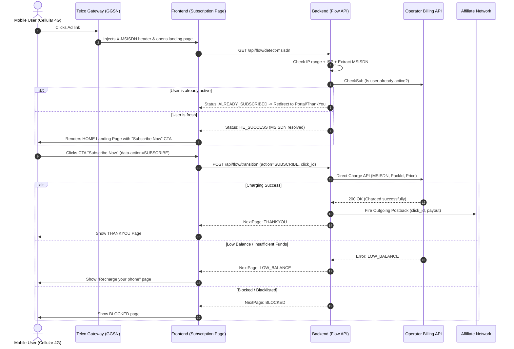

# 01 — Header Enrichment (HE) / Header Injection Flow

> **Identifier:** `HEADER_INJECTION` (Also known as `MSISDN_ONLY` or 1-Click WAP Flow)  
> **Source Files:**  
> - Backend: `backend/src/modules/flow/flows/HeaderInjection.js`, `backend/src/modules/flow/he/`, `backend/src/modules/flow/core/page-resolver.js`  
> - Frontend: `frontend/src/pages/subscription/he/`, `frontend/src/pages/subscription/useHeDetect.js`  
> - Telco Precedents: Safaricom (Kenya), Zain (Iraq/Sudan), MTN, etc.

---

## 1. Header Enrichment (HE) Kya Hota Hai?

Jab koi user apne **Mobile Cellular Data (3G/4G/5G)** se internet chala raha hota hai, toh uska internet direct telecom operator (e.g. Safaricom, Airtel) ke Gateway GPRS Support Node (GGSN / PGW) se hokar guzarta hai.

Telecom operator ka Gateway HTTP request ke headers me user ka **Mobile Number (MSISDN)** secretly inject (enrich) kar deta hai:
* `X-MSISDN: 254712345678`
* `X-FH-MSISDN: 254712345678`
* `MSISDN: 254712345678`

**Iska Sabse Bada Fayda:** User ko apna mobile number type karne ki zaroorat nahi padti aur na hi OTP enter karna padta hai! Yeh **1-Click Subscription Flow** hota hai jiska Conversion Rate sabse high (15% - 35%) hota hai.

---

## 2. Complete End-to-End Lifecycle



---

## 3. Step-by-Step Breakdown

### Step 1: Detect Phase (`GET /api/flow/detect-msisdn`)
1. User tracking URL par land hota hai:  
   `/subscription?tracking_campid=CAMP123&click_id=XYZ&campid=VENDOR_A`
2. Frontend `useHeDetect` hook call karta hai:  
   `GET /api/flow/detect-msisdn`
3. Backend check karta hai:
   - **Cellular IP Check:** Kya request carrier ke allocated IP range se aayi hai?
   - **Header Extraction:** Headers check karta hai (`x-msisdn`, `x-up-calling-line-id`, etc.).
   - **CheckSub Call:** Carrier ke local database ya external checksub API ko query karta hai ki user pehle se subscriber toh nahi hai.

### Step 2: Page Render
- Agar MSISDN mil gaya aur user fresh hai: Frontend par `HOME` page render hota hai.
- MSISDN ko session storage me encrypted/masked state me save kar liya jata hai.

### Step 3: 1-Click Transition (`POST /api/flow/transition`)
- User jaise hi visual button click karta hai (jisme `data-action="SUBSCRIBE"` laga hai).
- Frontend backend ko transition request bhejta hai.
- Backend operator ke billing gateway ko API hit karta hai:
  ```json
  {
    "msisdn": "254712345678",
    "campaignId": "CAMP123",
    "packId": "DAILY_20KES",
    "clickId": "XYZ"
  }
  ```

### Step 4: Outcome & Attribution
- Carrier user ke balance se 20 KES deduct karta hai aur success response deta hai.
- Backend `conversions` table me record insert karta hai.
- Affiliate network ko postback hit karta hai (`https://vendor.com/postback?click_id=XYZ`).
- User ko `THANKYOU` page par redirect kiya jata hai.

---

## 4. What Happens if HE Fails? (HE Miss / WiFi Users)

`HEADER_INJECTION` mode me `allowsHe: true` hota hai aur `requiresOtpNode: false`.
* **Agar user WiFi par hai ya telecom proxy ne header strip kar diya:**
  * Backend detect response dega: `{ status: 'HE_FAILED', reason: 'NO_MSISDN' }`
  * Kyunki is flow me OTP screen nahi hoti, isliye configuration ke hisaab se:
    1. Ya toh user ko **`ERROR`** ya **`WAP_BLOCKED`** page par redirect kiya jayega ("Please turn off WiFi and use Mobile Data").
    2. Ya fir Campaign ke Failover URL par bhej diya jayega.
* *(Note: Agar aapko WiFi users ko bhi convert karna hai, toh `BOTH` flow use karein — see [03-BOTH-HYBRID-FLOW.md](file:///d:/dddd/docs/flows/03-BOTH-HYBRID-FLOW.md)).*

---

## 5. Key Configuration Flags in Code

```javascript
// backend/src/modules/flow/flows/HeaderInjection.js
export default {
  id: 'HEADER_INJECTION',
  allowsHe: true,            // HE Detection enabled
  startConfig: HE_START,     // runHe: true, runBlocklist: true, runChecksub: true
  requiresOtpNode: false,    // No OTP input box
  needsIspResolve: true,     // Validates Telco cellular ISP IP
  conversionRule: 'subscribe_or_callback',
  packsOnHomeNoPhone: { nextPage: 'ERROR', useFailRedirect: true }
};
```
