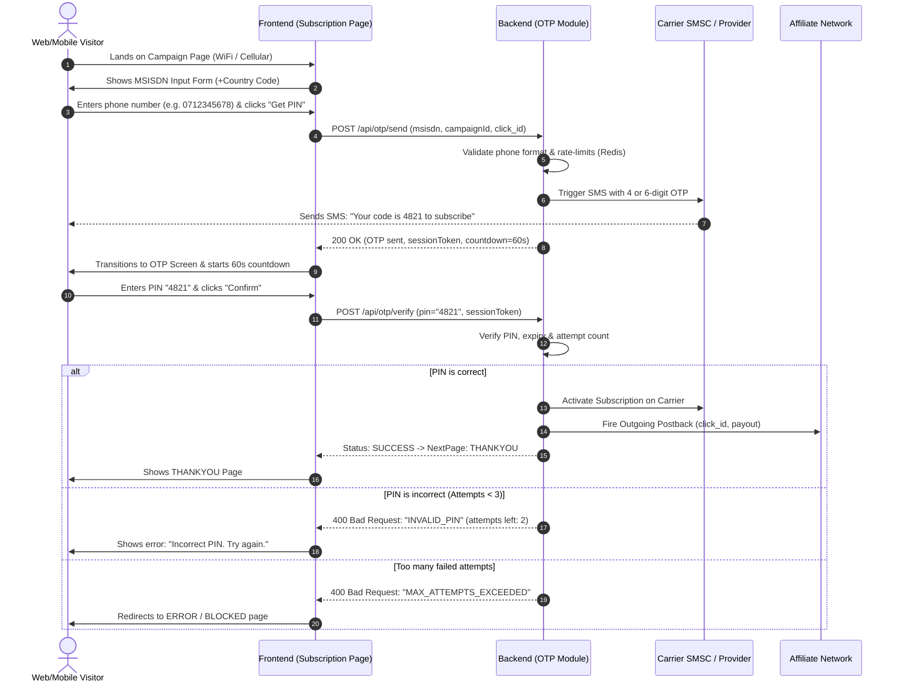

# 02 — OTP Only Verification Flow

> **Identifier:** `OTP_ONLY`  
> **Source Files:**  
> - Backend: `backend/src/modules/flow/flows/OtpOnly.js`, `backend/src/modules/otp/`, `backend/src/modules/otp/send/`, `backend/src/modules/otp/verify/`  
> - Frontend: `frontend/src/pages/subscription/otp/`, `frontend/src/services/api/otp.js`  
> - Applicable Networks: Any network (WiFi, 3G, 4G, 5G, Desktop, Broadband)

---

## 1. OTP Only Flow Kya Hota Hai?

Yeh classic **2-Step Verification Flow (PIN Flow)** hai. Jab telecom operator Header Enrichment support nahi karta ya user **WiFi / Broadband** par hota hai, tab user ko manually apna phone number enter karna padta hai aur SMS me aane wala One-Time Password (OTP) verify karna padta hai.

Is flow ka benefit yeh hai ki yeh **kisi bhi device aur network (WiFi/Data/PC)** par bina kisi carrier restriction ke chalta hai.

---

## 2. Complete End-to-End Lifecycle



---

## 3. Step-by-Step Breakdown

### Step 1: MSISDN Input & Format Validation
- User input box me number enter karta hai.
- Frontend me `resolvePhoneNumber.js` aur `inputRestrictions.js` auto-clean karte hain:
  - Non-numeric characters remove karta hai.
  - Country code automatically prepend karta hai (e.g. `0712...` $\rightarrow$ `254712...`).
  - Min/Max length enforce karta hai.

### Step 2: OTP Generation & Dispatch (`POST /api/otp/send`)
Backend me:
- **Rate Limiting:** Check karta hai ki ek hi number par 1 minute me multiple requests toh nahi aa rahi hain (Redis lock).
- **OTP Generation:** Cryptographically secure 4-digit ya 6-digit PIN generate karta hai.
- **SMS Provider Routing:** Operator configuration ke mutabiq request pass hoti hai:
  - Carrier Direct SMSC
  - Partner Provider (Infobip, Twilio, RouteMobile)
- Redis me session store hota hai:
  ```json
  {
    "msisdn": "254712345678",
    "pin": "4821",
    "attempts": 0,
    "expiresAt": 1700000000
  }
  ```

### Step 3: Countdown & Resend Handling
- Frontend me `otpCountdown.js` 60 seconds ka timer start karta hai.
- User timer khatam hone se pehle dobara request nahi bhej sakta.
- Timer expire hone ke baad "Resend PIN" button enable hota hai.

### Step 4: OTP Verification (`POST /api/otp/verify`)
- User PIN daal kar submit karta hai.
- Backend matching verify karta hai:
  - Agar match hua: Carrier billing trigger hoti hai $\rightarrow$ Database me conversion save hoti hai $\rightarrow$ Postback trigger hota hai $\rightarrow$ User `THANKYOU` page par pahunchta hai.
  - Agar match nahi hua: Attempt counter increment hota hai. 3 se zyada galat attempts par session block kar diya jata hai.

---

## 4. Key Configuration Flags in Code

```javascript
// backend/src/modules/flow/flows/OtpOnly.js
export default {
  id: 'OTP_ONLY',
  allowsHe: false,           // HE disabled
  startConfig: {
    runHe: false,
    runBlocklist: true,
    runChecksub: true,
  },
  requiresOtpNode: true,     // Mandates OTP node on flow canvas
  needsIspResolve: false,    // Works across any ISP / WiFi
  conversionRule: 'subscribe_or_callback',
  packsOnHomeNoPhone: { nextPage: 'OTP', useFailRedirect: false }
};
```
