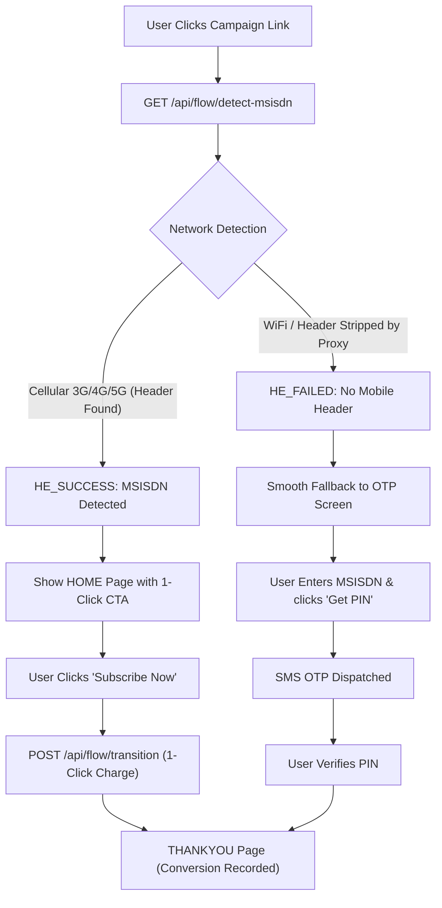

# 03 — BOTH (Hybrid HE + OTP Fallback) Flow

> **Identifier:** `BOTH`  
> **Source Files:**  
> - Backend: `backend/src/modules/flow/flows/Both.js`, `backend/src/modules/flow/core/page-resolver.js`  
> - Frontend: `frontend/src/pages/subscription/useHeDetect.js`, `frontend/src/pages/subscription/otp/`  
> - Primary Benefit: **Maximum Conversion Rate (Zero Traffic Wastage)**

---

## 1. BOTH Flow Kya Hota Hai?

Jab aap digital ads (Google, Facebook, TikTok, DSPs) chalate hain, toh aapko pata nahi hota ki visitor **Mobile Data** par hai ya **Ghar/Office ke WiFi** par hai.
* Agar aap sirf `HEADER_INJECTION` lagate hain, toh WiFi users block ho jayenge (paisa barbaad).
* Agar aap sirf `OTP_ONLY` lagate hain, toh Mobile Data users ko faltu me number aur OTP type karna padega (drop-off badh jayega).

Isliye **`BOTH` (Hybrid Flow)** banaya gaya hai:
* **Cellular Data Users:** Inko bina kuch type kiye **1-Click HE Subscribe** milta hai.
* **WiFi / Missing Header Users:** Inko bina error dikhaye automatically **OTP Screen** par switch kar diya jata hai.

---

## 2. Dynamic Decision Tree & Sequence



---

## 3. Step-by-Step Working

### Phase 1: Silent Detection on Page Load
1. User landing page par aata hai.
2. Background me `useHeDetect` hook `GET /api/flow/detect-msisdn` call karta hai.
3. Backend check karta hai:
   - Kya `X-MSISDN` header present hai?
   - Kya IP address authorized Telco range ka hai?

### Phase 2A: The Fast Path (HE Success)
- Agar number mil gaya:
  - Backend session me MSISDN bind kar deta hai.
  - Page par normal **"Subscribe"** button active ho jata hai.
  - Button click hone par seedhe carrier billing API hit hoti hai.
  - **Result:** Sub-second conversion bina kisi user input ke.

### Phase 2B: The Fallback Path (HE Miss / WiFi)
- Agar number nahi mila (user WiFi par hai):
  - Backend return karta hai: `{ status: 'HE_MISS', allowsOtpFallback: true }`.
  - Frontend crash ya error page dikhane ke bajaye silently user ko **OTP Input Screen** par guide karta hai.
  - User apna number daalta hai aur normal OTP flow se subscribe kar leta hai.

---

## 4. Key Configuration Flags in Code

```javascript
// backend/src/modules/flow/flows/Both.js
export default {
  id: 'BOTH',
  allowsHe: true,            // HE Detection try karo
  startConfig: HE_START,     // Cellular header reading
  requiresOtpNode: true,     // Flow canvas me OTP node hona zaroori hai (fallback ke liye)
  needsIspResolve: true,     // Cellular ISP check enabled
  conversionRule: 'subscribe_or_callback',
  packsOnHomeNoPhone: { nextPage: 'OTP', useFailRedirect: false } // Agar phone na mile toh OTP page par bhejo
};
```

---

## 5. Summary
Campaigns ke liye **`BOTH` flow sabse best practice** maana jata hai kyunki yeh:
1. Mobile Data users se 1-click high-CR conversion leta hai.
2. WiFi users ko waste nahi hone deta, balki OTP se recover kar leta hai.
