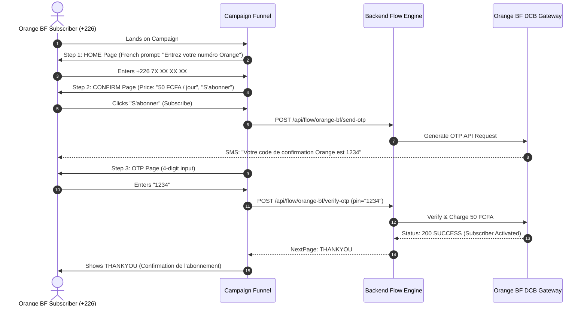

# 04 — Direct Carrier Billing (DCB) Flows

> **Identifiers:** `ORANGE_BF` & `UNIVERSE_DCB`  
> **Source Files:**  
> - Backend: `backend/src/modules/flow/flows/OrangeBf.js`, `backend/src/modules/flow/flows/UniverseDcb.js`, `backend/src/modules/flow/dcb/`  
> - Frontend: `frontend/src/components/dashboard/api-config/flows/OrangeBfTab.jsx`, `frontend/src/pages/subscription/dcb/`  
> - Precedents: Orange Burkina Faso, Universe DCB Gateway

---

## 1. Direct Carrier Billing (DCB) Kya Hota Hai?

**DCB (Direct Carrier Billing)** ek aisa payment method hai jisme consumer bina kisi Credit Card, Debit Card ya Bank Account ke digital content khareedta hai — **paisa seedhe uske Mobile SIM balance (prepaid airtime) ya monthly phone bill se deduct hota hai**.

Aapke project me do prominent DCB flows configured hain:
1. **Orange Burkina Faso (`ORANGE_BF`):** West African francophone market ke liye customized flow.
2. **Universe DCB (`UNIVERSE_DCB`):** Global multi-operator DCB aggregator integration.

---

## 2. Flow A: Orange Burkina Faso (`ORANGE_BF`)

Orange Burkina Faso (+226) me Telco regulations ke mutabiq French language me strict 3-step compliance flow mandatory hota hai.



### Key Technical Rules for Orange BF:
- **Phone Prefix Validation:** Number lazmi taur par `+226` aur valid Orange BF prefix (`70`, `74`, `75`, `76`, `77`) se start hona chahiye.
- **Conversion Rule (`otp_payout`):** Affiliate ko conversion tabhi count hoti hai jab 4-digit PIN successfully bill ho jata hai.
- **Flow Lock (`isFlowLocked: true`):** Regulatory reasons se iske steps (HOME $\rightarrow$ CONFIRM $\rightarrow$ OTP $\rightarrow$ THANKYOU) ko flow builder me randomly alter nahi kiya ja sakta.

---

## 3. Flow B: Universe Telecom DCB (`UNIVERSE_DCB`)

Universe DCB ek aggregator flow hai jo telecom billing gateways ke saath API-driven direct charge handle karta hai:

* **Dual Detection Capability:** Yeh cellular mobile data par **Header Enrichment (`allowsHe: true`)** support karta hai, aur WiFi par fallback.
* **Dummy / Test Pages Support (`useDcbDummyPages: true`):** Marketers bina real telecom charges ke local sandbox me complete payment loop test kar sakte hain.
* **Immediate vs Delayed Billing:**
  - Aggregator turant response deta hai: `PENDING_BILLING`.
  - Backend job queue (BullMQ) 30 minutes baad checksub query execute karti hai to verify actual carrier debit.

---

## 4. Key Configuration Flags in Code

```javascript
// backend/src/modules/flow/flows/OrangeBf.js
export default {
  id: 'ORANGE_BF',
  allowsHe: false,
  requiresOtpNode: true,
  isFlowLocked: true,
  conversionRule: 'otp_payout',
  wapBlockedMessage: 'This service is only available for Orange Burkina Faso subscribers (+226).'
};

// backend/src/modules/flow/flows/UniverseDcb.js
export default {
  id: 'UNIVERSE_DCB',
  allowsHe: true,
  startConfig: HE_START,
  useDcbDummyPages: true,
  needsIspResolve: true,
  conversionRule: 'subscribe_or_callback'
};
```
