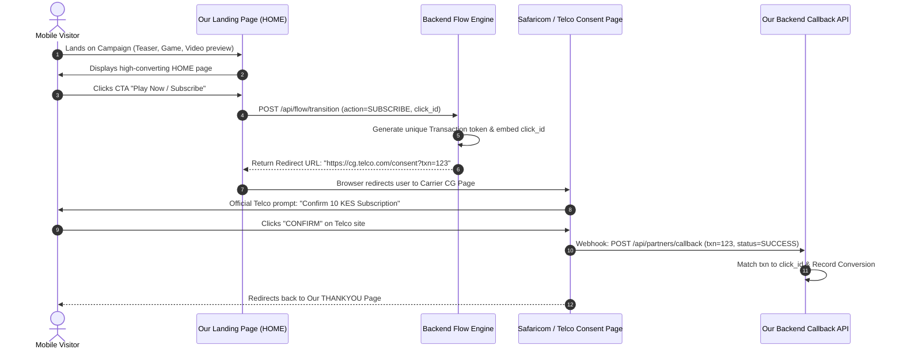

# 05 — Consent Gateway (CG) & Zero-Step Flows

> **Identifiers:** `CG_HOME` & `NONE`  
> **Source Files:**  
> - Backend: `backend/src/modules/flow/flows/CgHome.js`, `backend/src/modules/flow/flows/None.js`  
> - Concept: Operator-Hosted Consent Gateway (e.g. Safaricom CG, MTN CG)  
> - Regulatory Precedent: Telecom Regulatory Authorities jahan 3rd-party websites par OTP ya direct charge allow nahi hota.

---

## 1. Operator Consent Gateway (CG) Kya Hota Hai?

Kayi deshon (jaise Kenya, UAE, Saudi Arabia) me government regulations bohot sakht hoti hain. Telecom companies 3rd-party websites (aapke landing page) ko user ka mobile number lene ya charge karne ki permission **nahi** deti.

Iske bajaye, operator ek **Dedicated Consent Gateway (CG URL)** deta hai:
* User aapki site se redirect hokar **Carrier ke official portal** (e.g. `https://cg.safaricom.com/...`) par jata hai.
* Wahan operator official branding ke saath puchhta hai: *"Do you agree to subscribe for 10 KES/day?"*
* Jab user wahan "Accept" karta hai, toh carrier hamare backend webhook par ek **Callback** bhejta hai.

---

## 2. Flow A: `CG_HOME` (Landing Page $\rightarrow$ Operator CG)

Is flow me marketer pehle user ko apna customized content dikhata hai:



---

## 3. Flow B: `NONE` (Zero-Step Instant CG Redirect)

`NONE` flow ka naam isliye "NONE" hai kyunki isme koi intermediate landing page nahi hota:
* **Immediate Redirect:** User jaise hi affiliate ad par click karta hai, backend user ko bina koi page dikhaye **turant Carrier Consent Gateway URL** par redirect kar deta hai.
* **Kab use hota hai:** 
  - Jab traffic pehle se kisi pre-lander ya app wall se pre-qualified hota hai.
  - Jab advertiser chahta hai ki 0% bounce rate rahe aur direct telco page khule.

---

## 4. Key Configuration Differences

| Feature | `CG_HOME` | `NONE` |
|---|---|---|
| **Entry Page** | Displays `HOME` Landing Page | No page (Instant HTTP 302 Redirect) |
| **`isLandingCg`** | `false` | `true` |
| **`isSubscribeCg`** | `true` | `true` |
| **Identity Check** | Null Identity (`isNullIdentity: true`) | Null Identity (`isNullIdentity: true`) |
| **Conversion Trigger** | Operator Webhook Callback | Operator Webhook Callback |

---

## 5. Code Definitions

```javascript
// backend/src/modules/flow/flows/CgHome.js
export default {
  id: 'CG_HOME',
  allowsHe: false,
  startConfig: { runHe: false, runBlocklist: false, runChecksub: false },
  isNullIdentity: true,
  isLandingCg: false,
  isSubscribeCg: true,
  conversionRule: 'operator_callback',
};

// backend/src/modules/flow/flows/None.js
export default {
  id: 'NONE',
  allowsHe: false,
  startConfig: { runHe: false, runBlocklist: false, runChecksub: false },
  isNullIdentity: true,
  isLandingCg: true,          // Landing par hi CG bhej do
  isSubscribeCg: true,
  conversionRule: 'operator_callback',
};
```
