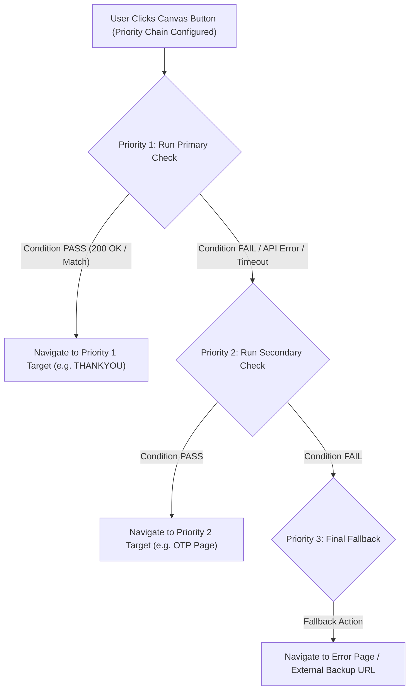

# 06 — Priority Chain Fallback Flow (Dynamic Button Engine)

> **Concept:** Multi-Tiered Cascading Action Engine  
> **Source Files:**  
> - Frontend: `frontend/src/pages/subscription/runPriorityChain.js`, `frontend/src/pages/subscription/priority/`, `frontend/src/editor/shell/PriorityChainModal.jsx`  
> - Use-Case: Complex multi-operator billing, dynamic fallback routes configured per-button in GrapesJS Editor.

---

## 1. Priority Chain Kya Hai?

Jab aap landing page design karte hain, toh ek button par sirf ek simple link lagana kaafi nahi hota. Real-world marketing me aapko **Cascading Fallbacks (Priority 1 $\rightarrow$ Priority 2 $\rightarrow$ Priority 3)** chahiye hote hain:

> **Example Business Rule:**  
> 1. **Priority 1:** Pehle check karo ki user ka carrier direct API billing support karta hai kya? Agar API 200 OK de de $\rightarrow$ Toh seedhe `THANKYOU` page par le jao.  
> 2. **Priority 2 (Agar P1 fail hua):** Agar API error de ya user WiFi par ho $\rightarrow$ Toh user ko `OTP` page par bhej do.  
> 3. **Priority 3 (Agar P2 bhi fail hua):** Agar OTP gateway down ho $\rightarrow$ Toh backup advertiser link par redirect kar do.

Is cascading logic ko **Priority Chain Engine** kehte hain.

---

## 2. Execution Flow Diagram



---

## 3. Step-by-Step Technical Execution

### Step 1: Canvas Button Binding
GrapesJS editor me marketer button select karke Property Panel me **"When Clicked $\rightarrow$ Try checks in order"** choose karta hai.
Button par attributes store ho jate hain:
```html
<button 
  data-action="PRIORITY_CHAIN"
  data-priority-1-type="API_CHECK"
  data-priority-1-url="https://api.carrier.com/v1/check"
  data-priority-1-pass="THANKYOU"
  data-priority-2-type="PAGE_NAV"
  data-priority-2-pass="OTP"
  data-priority-3-type="EXTERNAL_REDIRECT"
  data-priority-3-url="https://backupoffer.com">
  Get Started Now
</button>
```

### Step 2: Runtime Execution (`runPriorityChain.js`)
User jab button click karta hai, `useShadowInteractions` hook intercept karta hai:
1. **Priority 1 Execution (`priorityApiStep.js`):**
   - API URL sanitize karta hai (missing protocols check).
   - Async HTTP request bhejta hai with timeout protection (3000ms).
   - Agar status `200 OK` aur body me `status: "ACTIVE"` mila $\rightarrow$ Chain yahin STOP ho jayegi aur user `THANKYOU` page par redirect ho jayega.
2. **Priority 2 Cascade:**
   - Agar Priority 1 me API network timeout ho gaya ya status 400 mila:
   - Console me log hoga: `[Priority Chain] Priority 1 FAIL — cascading to Priority 2`.
   - Priority 2 execute hogi: User ko smoothly internal `OTP` page par navigate kara diya jayega.
3. **Priority 3 Final Guard:**
   - Agar Priority 2 bhi kisi wajah se unhandled fail hoti hai, toh user ko safe fallback external offer par redirect kar diya jata hai taaki traffic waste na ho.

---

## 4. Why This Architecture is Powerful
* **Zero Hardcoding:** Marketer bina developers ko bole canvas editor ke UI se khud dynamic rules configure kar sakta hai.
* **Fail-Safe:** Koi bhi API call landing page ko crash ya freeze nahi karti; har failure agle step par gracefully switch hoti hai.
