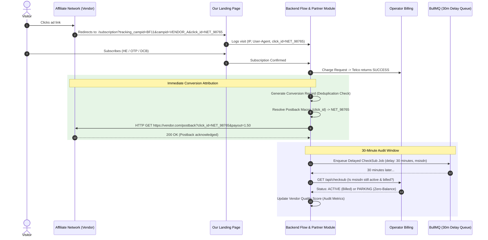
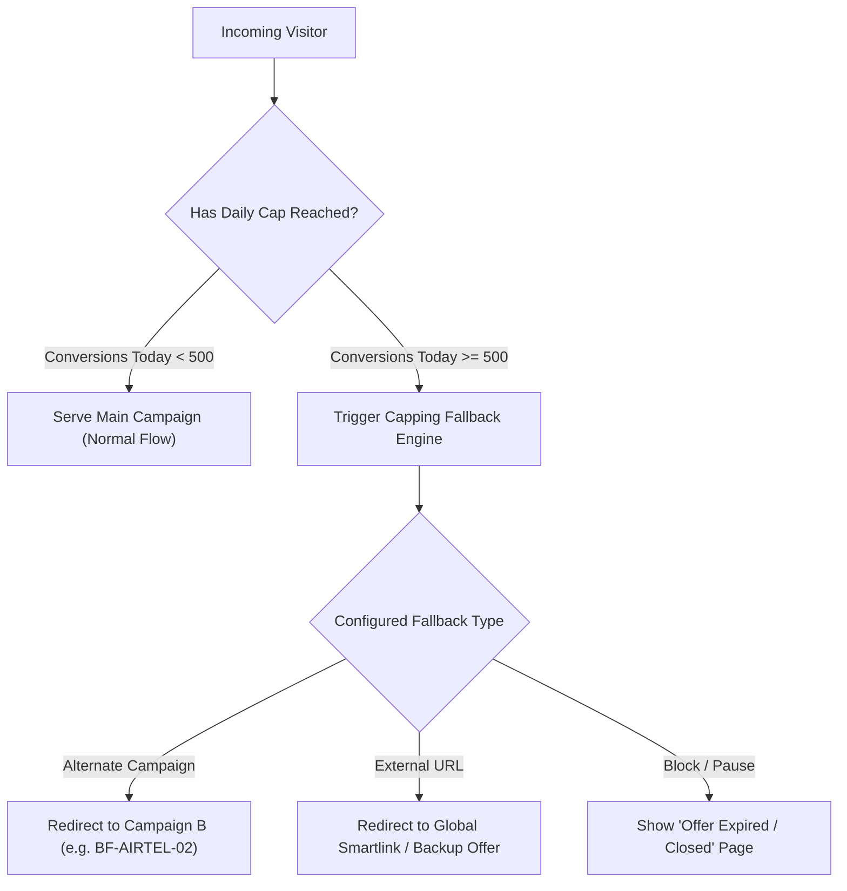

# 07 — Attribution, Postbacks & Capping Fallback Flow

> **Concept:** Performance Marketing Telemetry, Conversion Attribution & Traffic Failover  
> **Source Files:**  
> - Backend: `backend/src/modules/partners/`, `backend/src/modules/flow/core/capping-fallback.js`, `backend/src/modules/flow/checksub-worker/`  
> - Frontend: `frontend/src/pages/postbacks/`, `frontend/src/pages/postbackDayLogs/`, `frontend/src/pages/dashboard/components/VendorQualityTable.jsx`

---

## 1. High-Level Telemetry Architecture

Performance marketing me do cheezein sabse important hoti hain:
1. **Attribution & Postbacks:** Affiliate ad networks (e.g. Mobidea, ClickDealer) ko batana ki unke kis `click_id` se conversion generate hui aur unka commission record karna.
2. **Capping & Failover:** Agar advertiser ka daily quota (e.g. 1000 conversions/day) full ho gaya hai, toh agle traffic ko automatically doosre backup offer par bhej dena taaki ad spend waste na ho.
3. **30-Minute CheckSub Quality:** Pata lagana ki user ne sirf subscribe attempt kiya tha ya carrier ne uske account se actual paise deduct kiye.

---

## 2. The Conversion & Postback Lifecycle



---

## 3. Postback Macro Resolution

Affiliate vendors apna postback URL configure karte hain:
```
https://api.affiliatenetwork.com/postback?clickid={click_id}&payout={payout}&campaign={campaign}&txid={txid}
```

Backend postback dispatch karne se pehle runtime variables replace karta hai:
* `{click_id}` $\rightarrow$ `NET_98765`
* `{payout}` $\rightarrow$ `1.20` (USD)
* `{campaign}` $\rightarrow$ `BF-OBF-11`
* `{txid}` $\rightarrow$ `TXN_20261122_001`

**Anti-Duplication Engine:** Agar telecom gateway ya network kisi wajah se same conversion webhook 2 baar bhej de, toh system `click_id` aur `campaign_id` ke unique hash se duplicate detect kar leta hai aur vendor ko doosri baar postback fire nahi karta.

---

## 4. Conversion Capping & Fallback System

Advertisers aur telecom operators har offer ke liye daily budget/limit set karte hain (e.g. Max 500 conversions per day).



### Key Logic in `backend/src/modules/flow/core/capping-fallback.js`:
- Real-time Redis counter (`daily_conversions:camp_123:2026-11-22`) check karta hai.
- Agar cap limit exceed ho chuki hai, toh original landing page render karne ke bajaye HTTP 302 redirect generate karta hai fallback destination ke liye.
- Isse vendor ka traffic waste nahi hota aur conversions alternate monetization offer par shift ho jaati hain.

---

## 5. 30-Minute CheckSub Quality Score

Mobile VAS marketing me fraud se bachne ke liye yeh audit metric sabse powerful hai:
* **Attempts (Subscribed):** Kitne users ne form submit kiya.
* **30m Active (Billed):** 30 minute baad kin users ke account se actual paise deduct hue.
* **Parking / Zero-Balance:** Jin users ne subscribe toh kar liya lekin balance nahi tha.

Dashboard par **Quality %** automatically calculate hota hai:
$$\text{Quality \%} = \frac{\text{30m Active (Billed)}}{\text{Attempts (Subscribed)}} \times 100$$
Agar kisi vendor ki quality $20\%$ se kam ho, toh marketer us vendor ki capping kam kar sakta hai ya traffic pause kar sakta hai.
