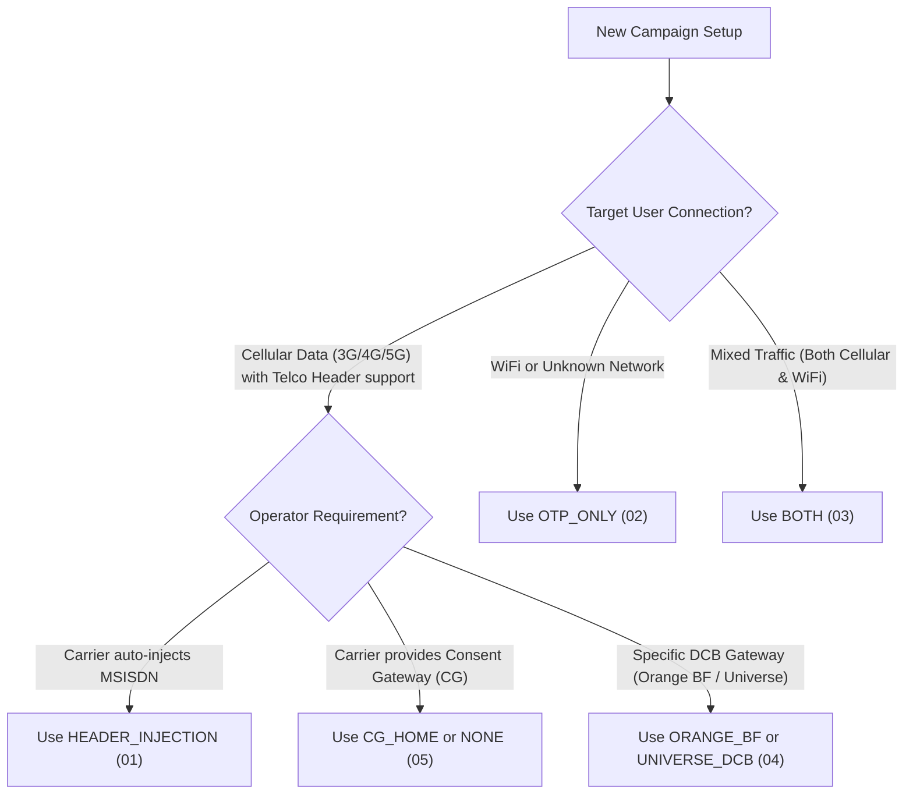

# TemplateCraft — All Subscription & System Flows Index

Aapke project me alag-alag Telecom Operators (Safaricom, Orange, Zain), Affiliate Networks aur User verification ke hisaab se **7 core verification flows** aur **2 critical background/system flows** implement kiye gaye hain.

Har flow ko samajhne ke liye alag-alag detailed `.md` files banayi gayi hain. Neeche unka complete index aur quick comparison diya gaya hai.

---

## 📚 Flows Directory & Direct Links

| # | Flow Name | Key Identifier (`mode`) | Primary Use-Case / Telco | Detailed Guide Link |
|---|---|---|---|---|
| **01** | **Header Enrichment (HE)** | `HEADER_INJECTION` / `MSISDN_ONLY` | Safaricom Kenya, Zain (Mobile Cellular Data users) | [01-HEADER-ENRICHMENT-FLOW.md](file:///d:/dddd/docs/flows/01-HEADER-ENRICHMENT-FLOW.md) |
| **02** | **OTP Only** | `OTP_ONLY` | Generic WAP traffic, WiFi users, SMS PIN verification | [02-OTP-VERIFICATION-FLOW.md](file:///d:/dddd/docs/flows/02-OTP-VERIFICATION-FLOW.md) |
| **03** | **Hybrid (HE + OTP Fallback)** | `BOTH` | Best conversion rate (Cellular par HE, WiFi par auto-OTP) | [03-BOTH-HYBRID-FLOW.md](file:///d:/dddd/docs/flows/03-BOTH-HYBRID-FLOW.md) |
| **04** | **Direct Carrier Billing (DCB)** | `ORANGE_BF` & `UNIVERSE_DCB` | Orange Burkina Faso, Universe Telecom DCB | [04-DIRECT-CARRIER-BILLING-FLOW.md](file:///d:/dddd/docs/flows/04-DIRECT-CARRIER-BILLING-FLOW.md) |
| **05** | **Consent Gateway & Zero-Step** | `CG_HOME` & `NONE` | Operator Hosted CG (Safaricom Hosted Page) | [05-CONSENT-GATEWAY-AND-NONE-FLOW.md](file:///d:/dddd/docs/flows/05-CONSENT-GATEWAY-AND-NONE-FLOW.md) |
| **06** | **Priority Chain Fallback** | *Button Action Engine* | Multi-tier fallback (Priority 1 API → Priority 2 OTP) | [06-PRIORITY-CHAIN-FALLBACK-FLOW.md](file:///d:/dddd/docs/flows/06-PRIORITY-CHAIN-FALLBACK-FLOW.md) |
| **07** | **Attribution, Postbacks & Capping** | *Telemetry & Failover* | Affiliate click tracking, 30m CheckSub, Capping redirect | [07-ATTRIBUTION-POSTBACK-AND-CAPPING-FLOW.md](file:///d:/dddd/docs/flows/07-ATTRIBUTION-POSTBACK-AND-CAPPING-FLOW.md) |

---

## ⚡ Quick Decision Guide: Kaun sa Flow Kab Use Karein?

---

## 🔍 Flow Comparison Matrix

| Flow Name | Allows HE? | Requires OTP Screen? | Needs Cellular IP/ISP? | Conversion Trigger | Typical Conversion Rate (CR%) |
|---|:---:|:---:|:---:|---|:---:|
| **HEADER_INJECTION** | ✅ Yes | ❌ No | ✅ Yes (Telco IP) | Click on Subscribe CTA | **15% – 35%** (Super Fast 1-Click) |
| **OTP_ONLY** | ❌ No | ✅ Yes | ❌ No (Any network) | Valid PIN Submit | **2% – 6%** (Higher friction) |
| **BOTH** | ✅ Yes | ✅ If HE misses | ✅ For HE step | Subscribe CTA or OTP verify | **10% – 20%** (Optimal) |
| **ORANGE_BF** | ❌ No | ✅ Yes (+226) | ❌ No | 4-Digit OTP verify | **4% – 8%** (French DCB) |
| **UNIVERSE_DCB** | ✅ Yes | ❌ Dummy/Auto | ✅ Yes | Billing API Callback | **8% – 18%** |
| **CG_HOME** | ❌ No | ❌ No (Carrier CG) | ❌ No | Operator Webhook Callback | **12% – 25%** |
| **NONE** | ❌ No | ❌ No (Instant) | ❌ No | Instant Operator CG redirect | **18% – 30%** |

---

Har flow ke deep technical mechanics, request/response payloads, frontend DOM handlers aur error codes samajhne ke liye upar diye gaye individual files ko open karein.
