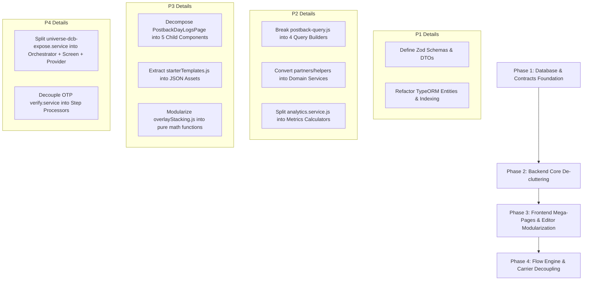

# WAP Manager (TemplateCraft) — Master Overhaul & Architecture Plan

> **Document Version:** 1.0  
> **Date:** November 2026  
> **Scope:** Full-Stack Architecture Overhaul (Backend, Frontend, Database, Data Models)  
> **Analysis Basis:** Direct analysis of all 518 codebase files (90,712 LOC), NOT based on legacy documentation.

---

## 1. Executive Summary & Problem Diagnosis

WAP Manager (TemplateCraft) ek high-throughput **Carrier Billing (DCB/HE/OTP) & Affiliate Postback Management System** hai, jisme ek in-house **Funnel Landing Page Builder** (GrapesJS based) integrated hai.

Codebase scan ke baad pata chala hai ki project functional hai lekin **architectural debt** ki wajah se extremely messy ho gaya hai:

### Codebase Metrics:
- **Total Code Files:** 518 files
- **Total Lines of Code:** 90,712 lines
- **Backend (`backend/src`):** 205 files, 35,722 lines
- **Frontend (`frontend/src`):** 277 files, 50,459 lines
- **Mega Files (> 300 lines):** 95 files (yehi sabse bada pain point hain)
- **Clean/Modular Files (< 150 lines):** 323 files (inhe touch karne ki jarurat nahi hai)

### The 4 Major Architectural Flaws:
1. **The "God-File" Anti-Pattern:** Multiple files 800 se 1,900 lines lambe hain (`starterTemplates.js` 1,905 lines, `overlayStacking.js` 1,293 lines, `PostbackDayLogsPage.jsx` 1,191 lines, `postback-query.js` 1,139 lines, `universe-dcb-expose.service.js` 1,025 lines). Ek naye developer ko ek feature samajhne ke liye hazaron lines scroll karni padti hain.
2. **"Helper Junk-Drawer" Anti-Pattern:** `backend/src/modules/partners` me controllers aur services sirf ~100 lines ke hain, jabki `helpers/` folder ke andar 3,800 lines ka core business logic dump kiya gaya hai!
3. **Implicit & Loose Data Schemas (JSON-in-TEXT):** `campaigns` aur `api_configs` tables me `flowConfig`, `otpConfigJson`, `heConfigJson` raw TEXT columns hain. Har service me alag-alag `JSON.parse` hota hai bina kisi DTO ya schema validation ke.
4. **Massive Frontend Monolith Components:** `PostbackDayLogsPage.jsx` aur `PostbacksPage.jsx` ek hi component file me data fetching, 10+ state variables, complex date math, table rendering, inline modals, aur export actions handle kar rahe hain.

---

## 2. Technology & Language Strategy: TypeScript vs Modern JavaScript

Aapne poocha tha: *"kya language change karni chahiye jaise agar TS me sahi hai toh JS kar do ya TS me kar do?"*

### Recommendation: **Modern JavaScript (ESM) + Zod Contracts + JSDoc Typed DTOs**

| Factor | Full TypeScript Rewrite | Modern JS + Zod & JSDoc (Recommended) |
| :--- | :--- | :--- |
| **Complexity** | Extremely High (90k LOC me type errors solve karne me hafte lagenge) | Very Low & Fast (zero build disruption) |
| **Runtime Safety** | Only compile-time; runtime pe fail ho sakta hai | Runtime validation via Zod schemas at API boundaries |
| **Developer Experience** | Build step slow, TS config conflicts with TypeORM | Instant IDE autocomplete, hover hints, zero build step |
| **Readability** | Type noise can make complex billing logic harder to read | Clean, crisp, standard JavaScript with clear object shapes |

**Decision:**
1. Codebase ko **Node.js Native ESM JavaScript** me rakhein.
2. Sabhi API boundaries, Carrier Payloads, aur DB configs ke liye **Zod Schemas** define karein (Zod frontend me already installed hai, backend me add karenge).
3. Complex business entities ke liye `.d.ts` declaration files ya JSDoc `@typedef` use karein jisse VS Code me 100% auto-complete aur hover type documentation mile bina code ko verbose banaye.

---

## 3. High-Level Target Architecture

```
                               ┌──────────────────────────────────────────────┐
                               │           FRONTEND (React 19 + Vite)         │
                               └──────────────────────┬───────────────────────┘
                                                      │ REST API (JSON)
                                                      ▼
┌────────────────────────────────────────────────────────────────────────────────────────────────────────┐
│                                       BACKEND (Express 5 + ESM)                                        │
│                                                                                                        │
│  ┌───────────────────────┐   ┌──────────────────────────┐   ┌───────────────────────────────────────┐  │
│  │   Presentation Layer  │   │     Application Layer    │   │             Domain Layer              │  │
│  │  - Thin Routers       │──▶│  - Feature Services      │──▶│  - Pure Domain Logic                  │  │
│  │  - Controllers        │   │  - Use-Case Orchestrators│   │  - Carrier Adapters (DCB/HE/OTP)      │  │
│  │  - Zod Validations    │   │  - Event Handlers        │   │  - Postback & Attribution Engine      │  │
│  └───────────────────────┘   └──────────────────────────┘   └───────────────────┬───────────────────┘  │
│                                                                                 │                      │
│                                                                                 ▼                      │
│                                                             ┌───────────────────────────────────────┐  │
│                                                             │          Infrastructure Layer         │  │
│                                                             │  - TypeORM Entities (Typed JSON)      │  │
│                                                             │  - Redis Caching & Distributed Locks  │  │
│                                                             │  - BullMQ Delayed Workers             │  │
│                                                             │  - Elasticsearch Logging              │  │
│                                                             └───────────────────────────────────────┘  │
└────────────────────────────────────────────────────────────────────────────────────────────────────────┘
```

---

## 4. Master Refactoring Roadmap & Phases

Overhaul ko 4 systematic phases me execute kiya jayega taaki ongoing functionality break na ho:



---

## 5. Detailed Documentation Index

Ye master plan 3 deep-dive documents me bifurcated hai:

1. [01_BACKEND_REFACTORING_PLAN.md](file:///d:/dddd/docs/refactor-plan/01_BACKEND_REFACTORING_PLAN.md) — Backend modules ka detailed breakdown, files to modify vs keep, proposed directory structure.
2. [02_FRONTEND_REFACTORING_PLAN.md](file:///d:/dddd/docs/refactor-plan/02_FRONTEND_REFACTORING_PLAN.md) — Frontend pages, GrapesJS editor, components and hooks decomposition plan.
3. [03_DATABASE_DATA_LAYER_PLAN.md](file:///d:/dddd/docs/refactor-plan/03_DATABASE_DATA_LAYER_PLAN.md) — Database schema, typed JSON fields, indexing, caching and data integrity guidelines.
